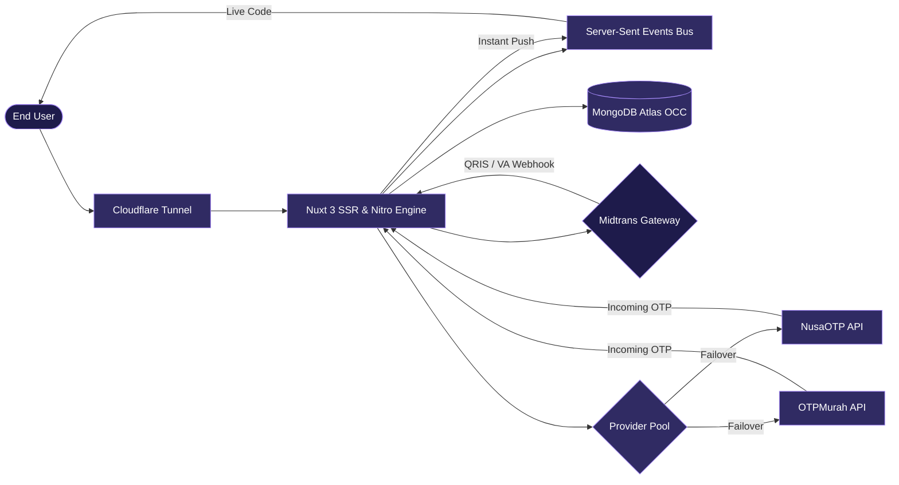
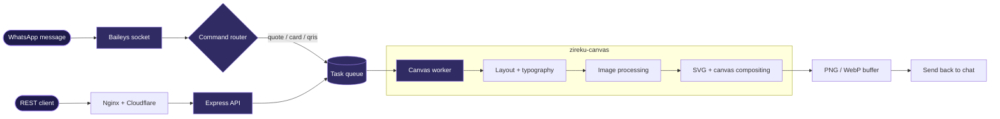

 

---

## About

I build things that draw images and talk to people, usually at the same time.

Most of my work sits between two worlds: a **canvas rendering engine** that has to match a real UI down to the pixel, and a **messaging bot** that has to answer in under a second while hundreds of chats are hitting it. I care about the boring parts that make those two things reliable: queues, retries, memory, deploys.

---

## Featured project

### [`smsvirtual.web-showcase`](https://github.com/Zireku/smsvirtual.web-showcase)

Enterprise virtual number and realtime SMS OTP verification platform with multi-provider failover (NusaOTP & OTPMurah), automated Midtrans payments (QRIS & Virtual Accounts), and zero-refresh Server-Sent Events (SSE). Built with Nuxt 3 SSR, Nitro engine, and MongoDB Atlas with Optimistic Concurrency Control.

* **Live Demo**: [https://otp.zireku.com](https://otp.zireku.com)
* **Architecture**: Nuxt 3 Universal SSR · Nitro Engine · Server-Sent Events · Midtrans Webhook Gateway · Cloudflare Tunnel

---

### [`zireku-canvas`](https://github.com/Zireku/zireku-canvas)

A pixel-accurate renderer for WhatsApp iOS-style quote bubbles, channel and group info cards, a QRIS builder, and a social media showcase generator. It runs on `@napi-rs/canvas`, with its own typography layer for text wrapping, emoji and mixed-script handling.

The same engine sits behind both the bot and the HTTP API, so a quote rendered in a chat and one fetched from an endpoint come out identical.

---

## Stack

| | |
|:--|:--|
| **Core & Backend** |         |
| **Graphics & Media** |     |
| **Automation & Bots** |     |
| **DevOps & Infra** |      |

---

## GitHub stats

 

---

## Contributions

  

<picture>
  <source media="(prefers-color-scheme: dark)" srcset="https://raw.githubusercontent.com/Zireku/Zireku/output/github-snake-dark.svg" />
  <source media="(prefers-color-scheme: light)" srcset="https://raw.githubusercontent.com/Zireku/Zireku/output/github-snake.svg" />
  
</picture>

---

## Find me

 

